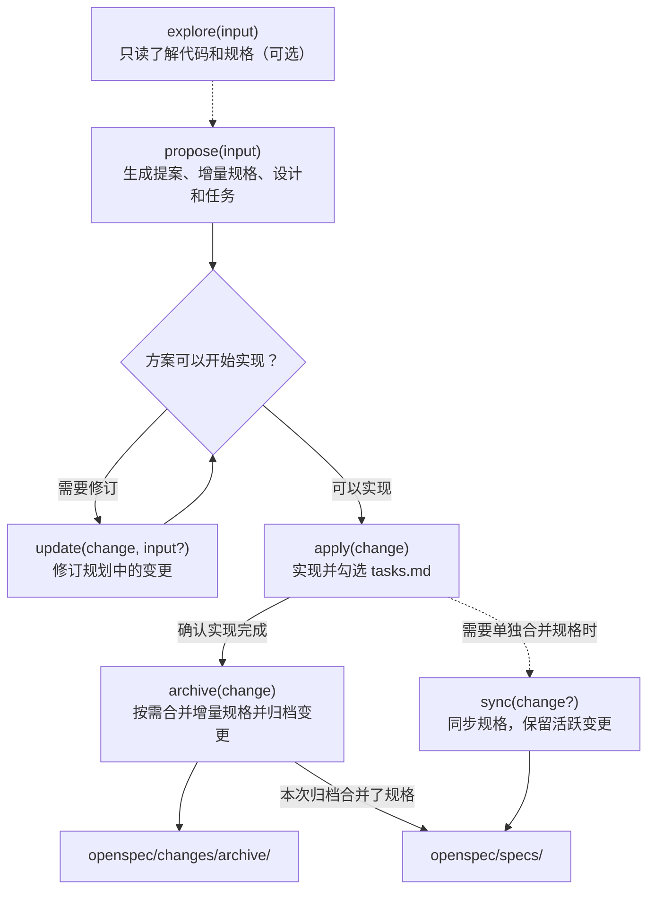

# spec — OpenSpec 工作流

把 `openspec` 技能包（`.dext/skill-packs/openspec`，由同目录的 `install.mjs` 生成）里的 6 个 skill 包成有类型提示的函数，省掉「记住 skill id」这一步。

```ts
import { spec } from "dext/api/spec/index";
```

每次调用启动一次独立的工作流，默认把结论写到 Output，同时返回 `{ kind: "skill", text }` 供脚本继续使用。想和 Agent 来回讨论，就在 Input 里直接选 skill。

六个 API 各有一个同名 TypeScript 文件，`index.ts` 提供统一的 `spec` 入口。

执行写入阶段的调用会在 `text` 末尾追加一段 git 观测结果：

```
Newly dirty paths:
- openspec/changes/add-video-export/proposal.md
- openspec/changes/add-video-export/tasks.md
```

没有新增路径时写 `Newly dirty paths: none.`。这份清单基于 `git status --porcelain -uall`，只记录本轮新进入 Git 改动列表的路径。运行前已经有改动的路径会单独列数量，同一路径再次编辑要看任务进度或文件内容。
工作区不是 git 仓库时这一段不出现，调用本身不受影响。

`spec.apply(change)` 启动一次由 `openspec-apply-change` skill 指导的 Agent 执行。skill 负责逐项推进，直到完成任务或需要暂停。API 读取 OpenSpec 清单，Output 显示结束进度、剩余数、下一项和 Agent 执行说明。前后快照来自同一个根目录和 store 时，Output 也会显示开始进度。只有任务来源、描述和顺序保持一致，且每个来源内的任务描述唯一时，才列出本轮新增勾选。Agent CLI 发出的任务消息和进度工具事件通过 Process 显示。

`spec.archive(change)` 需要确认时会打开对话框，显示产物或任务的警告，或列出各规格的同步评估。选择后，同一次调用会在原变更和 store 中继续。取消会结束本次调用。

`spec.update(change, input?)` 先只读检查并拟定修订。有明确改动时，对话框会逐项显示涉及的产物、拟改内容和原因。点击「确认修订」后，同一次调用会重新核对变更及范围，再写入已确认的修订。取消会结束调用，无需修改时直接返回结论。

`spec.sync(change?)` 先只读比较增量规格与主规格。省略变更 ID 时，只有一个含增量规格的活跃变更便直接评估，有多个则先选择。有待同步改动时，对话框会显示变更、OpenSpec 根目录、store、各主规格的拟改动以及跳过的规格。点击「确认同步」后，同一次调用会重新核对范围，再写入并校验已确认的改动。取消、无需同步或整轮评估受阻时直接返回。归档中选择「同步后归档」使用归档对话框的选择。

## 下一步

每个 `spec.*` 的 Output 和返回的 `text` 最后都有 `### 下一步`。结果可核实时会给出可直接执行的命令，等待确认、受阻或状态未知时会说明应先处理的事项。

| 调用 | 下一步 |
|---|---|
| `propose(input)` | 本轮新建且通过检查的 change 有任务清单时建议实施，缺任务时建议补齐 |
| `apply(change)` | `ready` → 再跑 `spec.apply("<name>")`，从第一项未勾任务继续；`all_done` → 按 CLI 提示完成审查或验证及要求的人工验收，再运行 `spec.archive("<name>")`；`blocked` → `openspec status --change "<name>" --json` 看缺哪件产物 |
| `archive(change)` | 确认目标已归档后，建议处理剩余变更或创建新变更 |
| `update(change, input?)` | 修订已写入或无需修改时建议实施 |
| `sync(change?)` | 确认所选变更已同步且主规格校验通过后，建议归档该变更 |
| `explore(input)` | 结论要改行为就 `spec.propose("…")` |

显式指定写入范围时，API 先用 CLI 验证范围，再从已验证的 `cwd` 启动 Agent。验证失败时调用停止。写入型 skill 报告实际处理的 change、根目录、store 和执行状态。`apply` 在执行前后查询已验证的显式范围，Agent 的报告可补充暂停状态。生成的后续调用带上已确认的范围。

`apply` 根据 OpenSpec 的 `state` 和 skill 的暂停状态给出下一步。状态为 `ready` 时，重跑建议的 `spec.apply(...)` 即可从首项待办继续。

`spec.propose`、`spec.update`、`spec.archive`、`spec.sync` 和 `spec.explore` 直接在 Output 展示对应 skill 的结论。产物、校验和归档结果由 skill 按所选 OpenSpec store 报告。

## 函数

| 函数 | 做什么 | 写文件 |
|---|---|---|
| `propose(input)` | 生成 proposal / spec delta / design / tasks | 只写 `openspec/changes/<name>/` |
| `apply(change)` | 按 `tasks.md` 逐条实现，边做边勾 | 改代码 + `tasks.md` |
| `archive(change)` | 合并 delta 进 `specs/`，整个 change 挪进 `archive/` | 改 `openspec/specs/` |
| `explore(input)` | 读代码和 specs 回答问题 | 不写 |
| `update(change, input?)` | 修订还在规划中的 change | 改 change 目录 |
| `sync(change?)` | 让 `specs/` 追上代码现状 | 改 `openspec/specs/` |

`change` 是变更名，对应 CLI 的 `--change "<name>"`。`input` 用于本次的额外要求。
五个写入型函数都接受一个可选的末尾参数 `{ store?, cwd?, root? }`。`store` 是已注册的 store ID，`cwd` 是工作区内运行 CLI 的目录，`root` 是预期的 OpenSpec 根目录。
例如可用 `spec.apply("add-video-export", { store: "team-specs" })` 在指定 store 内读取实施前后的进度。`explore(input)` 维持原有调用方式。

## 权限

`skill()` 默认只读，只有显式传 `apply: true` 才会拿到写入与命令执行权限：`src/features/workflow/host/runtime.ts`
里 `agent` 默认开启 `allowWorkspaceWrite`，`skill` 必须 `apply: true`，否则 `permission: "read-only"`。
只读的 `skill()` 没有 shell，`openspec new change` 跑不了，proposal / specs / design / tasks 只能写回回复
正文——这就是 `propose` 曾经「执行完什么文件都没有」的原因。

因此上表的写入阶段走 `agent({ skills: [id], apply: true, patch: false })`，加载对应的 `SKILL.md`，由当前 Agent CLI 写入工作区。`update` 和 `sync` 的预览阶段用 `apply: false`。
`explore` 保持 `skill()`，因为它本来就只读。

写权限要求可信本地工作区；不受信任时 `agent(apply: true)` 会直接拒绝，而不是悄悄降级成只读。
用于观测的 `terminal()` 同样要求可信工作区。

## 一轮



```ts
spec.propose("给视频标注加导出按钮");
// → openspec/changes/add-video-export/
//     proposal.md  ← 先读这个：Capabilities 和 Impact 两节
//     specs/video-annotation/spec.md
//     design.md
//     tasks.md
// 这一步不改代码。
// 下一步：spec.apply("add-video-export")

spec.apply("add-video-export");
// 真改代码，逐条勾 tasks.md。
// 中断了就再跑一遍同一条命令：从第一个未勾的任务继续。

spec.archive("add-video-export");
// 有待同步的增量时，在对话框选择同步后归档或跳过同步。
```

`openspec/specs/` 是唯一会长期留下的东西：它记「系统现在承诺什么行为」。`proposal.md` / `design.md` / `tasks.md` 都是这次改动的临时脚手架。

## 什么时候别用

改动没变「对外承诺的行为」——typo、一行 bug、纯重构、内部改名。直接改代码，别 propose。

判断就一句：**这次改动会不会让某个 `spec.md` 里的 Requirement 变**。

## 依赖

函数只是壳，真活由全局 CLI 干：

```bash
npm i -g @fission-ai/openspec      # 装一次
openspec list --json               # 应返回 root，不是 null
```

`root: null` 说明当前目录往上没有 `openspec/`，所有命令都会失败。

刷新 skill 文件（CLI 升级后），重跑包自带脚本：

```bash
node .dext/skill-packs/openspec/install.mjs
```

Resources → Skill → `openspec` 行右侧的 ▶ 按钮跑的是同一条命令（会先弹确认框显示具体命令行）。

它把 `openspec init --tools codex` 的产物写进 `.dext/skills/openspec-*`，并重写同目录的 `pack.json`。刷新后需要 Reload Window。

这 6 个 skill 默认在 `dext.hiddenSkills` 里：Input 菜单看不到它们，但 API 和已保存的选择照样能按 id
加载，`spec.*` 就是靠这一点工作的。

`openspec/config.yaml` 里的 `context:` 值得填几行——它是 proposal 理解这个仓库的唯一提示，现在空着，全靠 agent 现场读代码。
