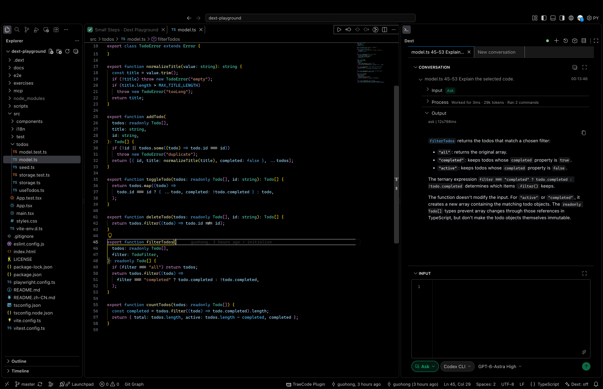
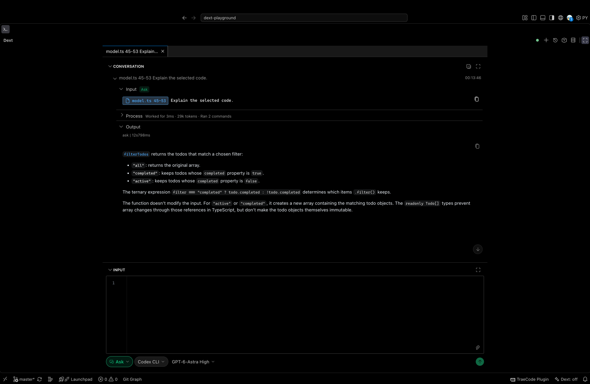
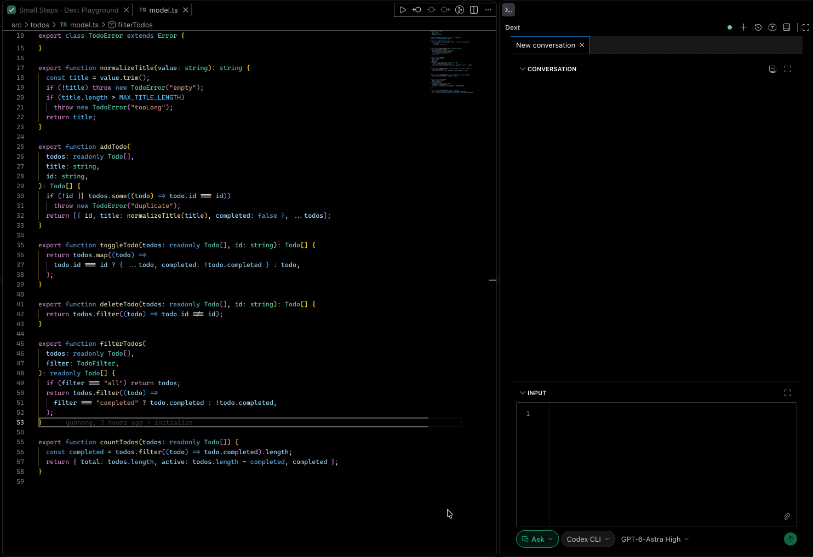
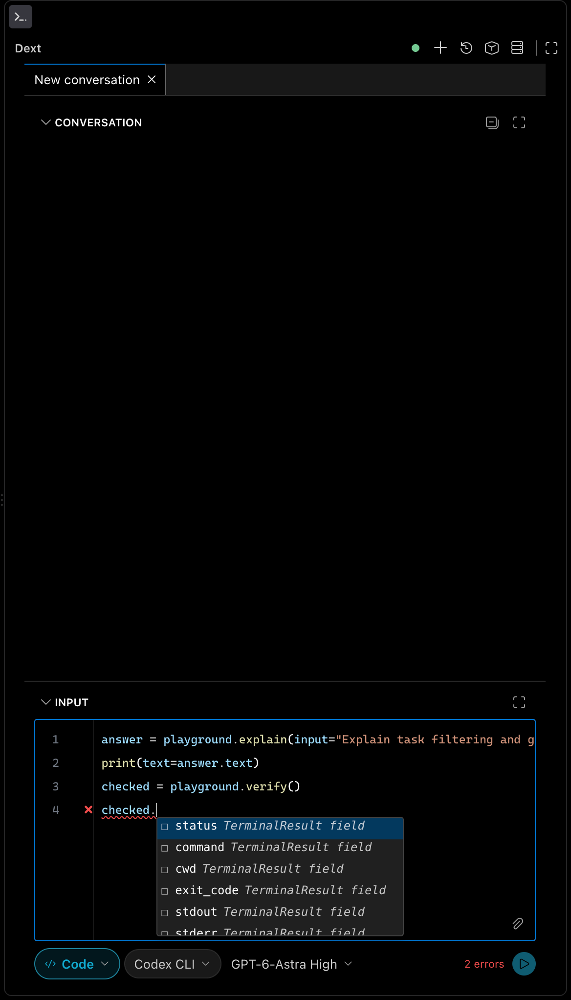
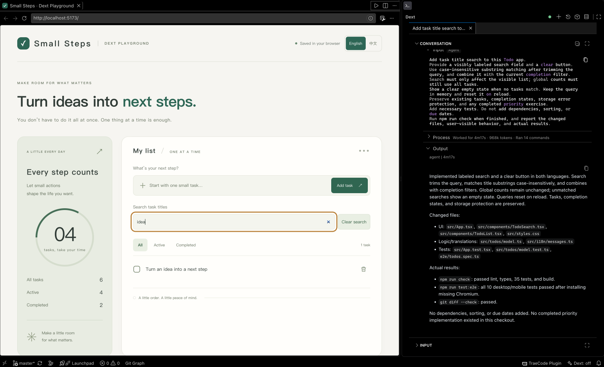

# Dext

[English](README.md) | 简体中文

Dext 是一款支持 AI 对话与类型化工作流的 Visual Studio Code 插件。你可以提问、委托代码修改、制定和执行计划，也可以通过 API、Skills 和 MCP 工具将重复任务变成可复用的工作流。



<details>
<summary>查看全屏布局</summary>



</details>

## 能做什么

| 模式 | 用途 | 输入 |
| --- | --- | --- |
| **Ask** | 理解代码、分析问题，不修改文件 | 自然语言 |
| **Agent** | 实现功能、修复问题、运行检查 | 自然语言 |
| **Plan** | 创建和修订计划，再点击 **Build** 实施 | 自然语言 |
| **Code** | 组合 API 调用，编写类型化工作流 | TypeScript |

执行 Plan 时，Dext 会在每轮回答后检查任务状态，自动继续未完成且未受阻的工作。任务全部报告完成后，还会单独请求最终自动验证，验证通过才显示 `Completed`。进度保存在会话历史中，不修改计划文件；暂停后再次点击 **Build** 会恢复同一计划中未变更任务的进度。

用户停止显示 `Stopped`，所有剩余任务都有明确外部阻塞时显示 `Blocked`；连续三轮没有新增完成项或新工具活动，或达到单次 64 轮上限时显示 `Incomplete` 并保留计划。普通回答结束不再等于计划完成。最终自动验证依赖 Agent 检查代码与测试并报告结果，宿主不能仅凭任务勾选独立证明实现正确。

你可以将文件和代码选区加入上下文，在 History 中继续对话，并从对话生成起始工作流。Code 模式在 Node 内核中运行 TypeScript，并提供 API 补全、参数提示、诊断和类型化结果字段。

从 VS Code 文件资源管理器拖动文件时，按住 **Shift**，在 Dext 输入框高亮后松开鼠标，即可在落点插入文件引用（ref）。支持多选文件一起拖入。

支持 **Codex CLI、Claude CLI 和 DeepSeek Harness**。

## 安装

需要 **VS Code 1.106 或更新版本**。执行 AI 任务前，请安装并登录其中一个受支持的 Agent CLI，Dext 使用该 CLI 的登录凭据。

Dext 默认位于副侧栏（VS Code 默认布局的右侧）。安装或更新后，未手动移动过的 Dext 会使用该默认位置；已手动调整的位置由 VS Code 保留。若仍显示在其他位置，可右键 Dext 标题，选择移动到副侧栏。

### 从插件商店安装

1. 在 VS Code 中打开扩展视图。
2. 搜索 `blooddot.dext`，选择发布者为 **blooddot** 的 **Dext**。
3. 点击 **安装**。

也可以打开 [Dext 商店页面](https://marketplace.visualstudio.com/items?itemName=blooddot.dext)。后续可在扩展视图中管理更新。

### 从 VSIX 安装

1. 从 [GitHub Releases](https://github.com/blooddot/dext/releases) 下载 `dext-<版本号>.vsix`。
2. 打开 VS Code 命令面板，执行 **Extensions: Install from VSIX...**（扩展：从 VSIX 安装）。
3. 选择下载的文件；如果出现提示，重新加载 VS Code。

手动安装的版本可通过安装新版 VSIX 更新。从源码构建见[开发指南](docs/development.zh-CN.md)。

## 快速上手

1. 在 VS Code 中打开项目文件夹，点击活动栏中的 Dext，或执行 **Dext: Focus Input**。
2. 在输入区域选择 Agent 和模型；如果选项未显示，展开 **More options（更多选项）**。需要修改可执行文件路径时，执行 **Dext: Configure Agent**。
3. 选择 **Ask**，输入“解释这个项目的结构”，点击 **Send**。需要分析具体代码时，在编辑器中选中代码，再点击 **Add to Dext**。
4. 需要修改代码时，选择 **Agent**。项目内修改使用 **Workspace write**；**Full access** 允许更广泛的访问。

较大的任务可以先选择 **Plan**，创建和修订实施计划。选中最终计划后，在同一模式点击 **Build** 执行。



*Ask 操作演示：选中代码 → Add to Dext → 输入“Explain the selected code.”。*

## 编写工作流

选择 **Code**，输入以下代码并点击 **Run**：

```ts
import { ask } from "dext";

const answer = await ask({ input: "解释这个项目的结构" });
console.log(answer.text);
```

一个 Code 轮次就是普通的 ES 模块，由 Dext 放在长期存活的 Node 子进程中按 TypeScript 运行。没有 Python 解释器，也没有独立的工作流语言：Node 内置模块（`import fs from "node:fs/promises"`）和工作区能解析的任意包都可以直接使用，顶层 `await` 也可用。API 参数和结果字段的补全与类型检查来自 VS Code 自身的 TypeScript 服务。

字符串、数组和对象就是普通 JavaScript 值：用模板字符串组合文本（`` `${answer.text} (${checked.exit_code})` ``），并使用标准库（`split`、`join`、`replace`、`toUpperCase`、`Math.max`、`Array.sort`、`text.slice`）。详见[文本与取值表达式](docs/workflows.zh-CN.md#文本与取值表达式)。

可复用的 API 以 TypeScript 模块保存在 `.dext/api/` 中。例如，创建 `.dext/api/team/analyze.ts`：

```ts
import { ask, type AskResult } from "dext";

export async function main(input: string): Promise<AskResult> {
  return await ask({ input });
}
```

`ask`、`agent`、`terminal` 等内置 API 从 `dext` 模块导入；自定义 API 按其在 `.dext/api` 下的路径导入。

在 Code 模式中，用同样的方式导入自定义 API：

```ts
import { main as analyze } from "dext/api/team/analyze";

const answer = await analyze("解释任务筛选逻辑和相关测试");
console.log(answer.text);
```

项目 API 需要受信任的工作区。你也可以右键 History 条目，选择 **Record Conversation as Dext Workflow**，生成起始文件后继续编辑。组合调用、Skills、规则和交互确认见[工作流与 API 参考](docs/workflows.zh-CN.md)。

Dext 会把 `dext` 类型声明生成到你的项目里——`.dext/api/dext.d.ts`，加上把 `dext` 映射到它的 `.dext/tsconfig.json` 和把该目录标记为 ESM、并声明其 API 文件编译所需的 `@types/node` 的 `.dext/package.json`——并在每次重新加载 API 时保持三者最新。这些文件里的路径全是相对路径，可以放心提交：`.dext/api/*.ts` 和输入区会在编辑时把诊断写入 **Problems** 面板，队友和 CI 在没装 Dext 的情况下也能做类型检查。详见[生成的类型](docs/workflows.zh-CN.md#生成的类型)。



*输入 `checked.` 时的字段补全。图中的 `playground.*` API 来自 Dext Playground。*

## 跟着 Playground 练习

[Dext Playground](https://github.com/blooddot/dext-playground) 是配套的 Todo 应用和实作教程。先运行应用，让 Dext 解释代码，再完成一次看得见的修改；之后按需练习计划、功能开发、测试、可复用 API 和 MCP 工具。

[开始首次体验](https://github.com/blooddot/dext-playground/blob/master/docs/getting-started.md)。



*完成搜索练习后的效果：列表按关键词展示匹配任务，全局统计保持不变。*

## 详细文档

| 文档 | 内容 |
| --- | --- |
| [工作流与 API](docs/workflows.zh-CN.md) | TypeScript Code 模式、内置与自定义 API、上下文、Skills、规则和 History |
| [Agent 配置](docs/agents.zh-CN.md) | CLI 配置、模型覆盖、DeepSeek Harness 预设与权限 |
| [MCP 配置](docs/mcp.zh-CN.md) | 工具清单、类型化结果、传输方式和凭据 |
| [项目知识](docs/project-development.zh-CN.md) | 项目文件、知识维度、编辑器标签和图表 |
| [开发与发布](docs/development.zh-CN.md) | 本地开发、检查、打包、发布和架构 |

## 项目知识与编辑器标签

Project、API、Global Resources 和 History 都作为编辑器标签打开：同一目标只保留一个页面，重载后会恢复同一个页面。Project 只展示长期内容——Overview、Knowledge 和 Diagrams，不显示 Hook 日志、任务清单或单次执行记录。

## 反馈与许可证

通过 [GitHub Issues](https://github.com/blooddot/dext/issues) 反馈问题或提出功能建议。请提供 Dext 和 VS Code 版本、复现步骤，以及移除凭据后的相关日志。

Dext 采用 [PolyForm Perimeter License 1.0.1](LICENSE)，并可另行协商商业授权。在遵守许可证的前提下，允许日常使用，包括企业内部使用。利用 Dext 向他人提供竞争性产品或服务，需要另行授权，即使该产品或服务免费提供。

授权范围与申请方式见[商业授权说明](COMMERCIAL-LICENSING.md)。本项目属于源码可见软件，不采用 OSI 认可的开源许可证。第三方组件继续遵循各自许可证。版本记录见 [CHANGELOG.md](CHANGELOG.md)。
