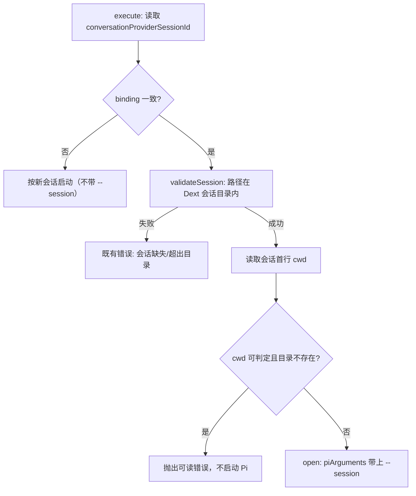

# Design

## Context

现状与本次约束（动机见 `proposal.md`，行为契约见 `specs/pi-host-compatibility/spec.md`）：

- Dext 以 RPC 模式启动 Pi，`--session-dir` / `--session` 由 `piArguments` 决定：`src/features/agents/host/piCommand.ts:92`。
- 恢复入口在 `PiAgentRunner.execute`：`src/features/agents/host/piAgentRunner.ts:326` 先用 `validateSession`（`piAgentRunner.ts:119`）确认路径在 Dext 会话目录内，`piAgentRunner.ts:333` 把它交给 `open`，最终变成 `--session`。该行之前还有一次 `open(..., undefined, true)`（`piAgentRunner.ts:329`）用于读取干净默认值，它不带 `--session`。
- 进程退出由传输层翻译成错误：`src/features/agents/host/piRpcTransport.ts:34` 生成 `Pi CLI exited before completing the request (code).` 并附 `Pi stderr: ...`。
- 模型选择有两处 `set_model`：`select`（`piAgentRunner.ts:240`，调用在 `:243`）与本轮模型发现 `discover`（`piAgentRunner.ts:268`，调用在 `:281`）。两处都不包装错误，失败时直接冒泡 `Pi set_model failed: <原因>`。
- Pi 1.5.2 的会话文件首行是 header，含 `cwd`（安装包 `docs/session-format.md`）；`docs/sessions.md` 明确「Other modes exit with an error」，即交互模式的 Continue / Fork / Cancel 不出现在 RPC 模式。
- 现状里 `validateSession` 只校验路径位置，不校验目录可用性。

## Goals / Non-Goals

**Goals:**

- 工作区丢失后的恢复给出可读、可行动、不依赖 Pi stderr 措辞的失败，并且不启动 Pi 进程。
- `set_model` 失败给出下一步动作，不改其它命令的错误透传。
- 把 Pi 1.5.x 的三项行为变化固定成文档与最小断言，且不改输出契约。

**Non-Goals:**

- 不改 `PiRpcTransport` 协议层（请求/响应匹配、退出清理、`taskkill`）。
- 不改 `media/pi-extension.mjs` 的工具注册与 `agent_before_settle` 提醒（`terminate` 与 `constrainedSampling` 属另一个 change）。
- 不改结果解析与 `failAgentResult`（属 `accept-plain-text-when-envelope-invalid`）。
- 不做 provider 原生结构化输出（`response_format` / `text.format` / `output_config.format`），不装第三方 structured-output 插件。
- 不加开关、配置项、抽象层或新模块目录；不带无关格式化。
- 不引入 `--fork`，Dext 不 fork 会话；不为旧会话做工作区重写或迁移。

## 实测结论

以下三项都用本机 Pi 1.5.2（`pi --version` → `1.5.2`）实测，作为「修代码」还是「只写文档」的依据。

### 1. 重命名工作区后恢复会话

做法：取一份真实会话文件，只把首行 `cwd` 改成不存在的目录（等价于工作区被改名/删除），再以 RPC 模式 `--session <path>` 启动，读取 `get_state`；对照组把同一文件的 `cwd` 指向仍存在的目录。

| 测量项 | 对照组（cwd 存在） | 实验组（cwd 不存在） |
| --- | --- | --- |
| 退出码 | 0 | 1 |
| stdout | `get_state` 正常响应 | 空，没有任何 RPC 响应 |
| stderr | 空 | `Stored session working directory does not exist: <cwd>` + `Session file: <path>` + `Current working directory: <cwd>` |
| 是否自动在当前目录继续 | — | 否 |

结论：**Pi 不会自动在当前目录继续**，本项保留为代码修复，不降级为纯文档。

同时修正任务描述里的一个前提：当前用户看到的并不只有 `Pi CLI exited before completing the request (code).`。实测经 `PiRpcTransport` 得到的完整文案是：

```
Pi CLI exited before completing the request (1).
Pi stderr: Stored session working directory does not exist: C:\...\renamed-away
Session file: C:\...\missing.jsonl
Current working directory: C:\...
```

所以真正的问题是：它被表述成进程崩溃、带两处绝对路径、没有下一步动作，而且完全依赖 Pi 往 stderr 写这句特定措辞（属于实现细节，随时可能变）。预检的价值是给出 Dext 自己的、带动作的说明，并省掉一次注定失败的 spawn。

### 2. 工具参数 coercion（1.5.2 的 `@earendil-works/pi-schema`）

直接编译该包并按 Pi 的方式调用 `coerce()`：

| 输入 | 输出 |
| --- | --- |
| `{ value: "ok", note: null }`（`note` 为可选属性） | `{"value":"ok"}` —— 可选属性上的显式 `null` 被丢弃 |
| `{ value: null }`（`value` 为必填 `string`） | `{"value":"null"}` —— 必填位置不丢，走字符串转换 |
| `{ questions: { id: "q1" } }`（`questions` 为数组） | `{"questions":[{"id":"q1"}]}` —— 单值被包成单元素数组 |

结论：与 `docs/extensions.md` 的描述一致，两条断言可以直接写死在既有测试里；Pi 侧无需 Dext 配合。

### 3. `cacheWarming` 与模型目录

1.5.2 的 `CHANGELOG.md` 第 53 行（1.5.1）：`cacheWarming` 默认从 `"streaming"` 改为 `"idle"`，空闲时最多 30 分钟继续保热 prompt cache；第 168 行（1.5.0）：内置模型目录换到 models.dev v2，realtime 与纯图像模型不再作为 chat 模型列出。两者都不需要 Dext 改代码，落文档即可。

## 验证结论

实现完成后在 Pi 1.5.2（`pi --version` → `1.5.2`）上用 `node <cli> --mode rpc --session <path>` 复核两条对照，并用本 change 的预检覆盖同一场景：

| 场景 | 实测结果 | Dext 侧 |
| --- | --- | --- |
| 重命名工作区后恢复（header 的 `cwd` 指向已不存在目录） | exit 1、stdout 空、stderr `Stored session working directory does not exist: ...` + `Session file: ...` + `Current working directory: ...`，不自动在当前目录继续 | 预检在 spawn 之前命中，回合失败并给出工作区已移动或删除的可读说明；测试断言日志中不新增进程 |
| 正常恢复（`cwd` 存在） | exit 0，`get_state` 正常响应 | 预检放行，Pi 以 `--session <path>` 启动并正常响应，与原路径一致 |
| 会话文件内容损坏（首行非 JSON） | exit 1、stderr `Error: Session file is not a valid pi session: <path>` | 预检返回 `undefined` 放行，错误仍由 Pi 给出，文案不含工作区说明 |

结论：预检解决的正是「注定失败的一次 spawn + 依赖 Pi stderr 措辞」的体验问题，且不会拦住 Pi 自己能处理的恢复。

## Decisions

### 决策 1：预检放在 `execute` 的恢复分支，不放传输层

`execute` 在 `:326` 拿到 `resume` 之后、`:333` 之前做判断，失败时直接抛错，`open` 与 `spawn` 都不会发生。



被否的替代方案：放进 `PiRpcTransport` —— 协议层不该懂会话语义，而且 `--session` 是 `piArguments` 拼出来的，传输层看不到「这是一次恢复」；放进 `piArguments` —— 那是纯函数，不该做文件 IO。

### 决策 2：同目录小助手 `src/features/agents/host/piSessionHeader.ts`

导出 `piSessionCwd(path: string): Promise<string | undefined>`。用 `open` + 64 KiB 缓冲逐块读，只在读到第一个换行时解析，避免把可能达到 `PI_SESSION_KEEP_BYTES`（512 MiB）的会话文件读进内存。解析只做 `JSON.parse` 后取字符串型 `cwd`。

容错分支（对应 spec 的「无法判断工作区时交回原有恢复路径」）：

| 情况 | 返回 | 结果 |
| --- | --- | --- |
| 文件不存在或不可读 | `undefined` | 放行，交给 `validateSession` 与 Pi |
| 首行不是 JSON 对象 | `undefined` | 放行，Pi 自己判定文件有效性 |
| `cwd` 缺失、为空字符串、非字符串 | `undefined` | 放行（旧会话可能没有这个字段） |
| 首行超过 64 KiB 仍没有换行 | `undefined` | 放行 |
| `cwd` 指向不存在的路径 | 该路径 | 拒绝，给出可读错误 |
| `cwd` 指向一个文件而不是目录 | 该路径 | 拒绝（Pi 无法在其中运行） |

判定用 `stat(cwd).isDirectory()`，任何 `stat` 异常都按「不存在」处理；但只有在能确定「不存在或不是目录」时才拒绝。

### 决策 3：错误文案沿用 Dext 现有英文单句 + 动作的写法

`The workspace recorded by this Pi session no longer exists (<cwd>), so the session cannot be resumed. It was moved or deleted. Start a new conversation, or start again in the new location.`

不提 fork（Dext 不 fork），不提供自动迁移；`<cwd>` 用会话里记录的原值，方便用户对照自己把目录改到哪去了。

### 决策 4：`set_model` 提示收在一个私有方法里，两处调用点共用

```ts
private async setModel(session: Session, provider: string, id: string, signal: AbortSignal): Promise<unknown> {
  try { return await session.transport.request("set_model", { provider, modelId: id }, 30000, signal); }
  catch (error) {
    // 取消必须原样透传，不能被改写成「模型下架」
    if (signal.aborted) throw error;
    throw new Error(`${error instanceof Error ? error.message : String(error)} The model may no longer be offered by Pi; refresh the model catalog in Dext: Configure Agent.`);
  }
}
```

`select`（`:243`）与 `discover`（`:281`）都改成调用它，避免两处文案漂移；`select` 里「`Pi did not select the requested model.`」这类后续判断保持原样。

被否的替代方案：在 `PiRpcTransport` 里按命令名拼提示 —— 那是协议层，且任何调用者都会被强行塞进一句 UI 建议；只在 `select` 加提示 —— 刷新模型目录正是走 `discover`，那才是用户最常撞到的那一处。自动切换模型也在此被否：用户存下的 ID 失效时，替用户挑一个模型会把「我选的模型」悄悄换掉。

### 决策 5：coercion 只在 Dext 边界上断言，不在 Dext 侧对抗

为什么不在 Dext 侧对抗 coercion：

1. **对抗点不存在。** coercion 发生在 Pi 内部（1.5.0 起所有工具参数统一走 `pi-schema`），Dext 扩展在 `execute` 里拿到的已经是规整后的参数。Dext 侧再补一次「`null` 归一化」只能处理「已经被丢弃或包装过」的值，对语义没有影响，却制造第二条真相。
2. **契约不该跟着 `pi-schema` 走。** 结果契约是用户 schema，`nullable` 表达的是用户的意图；为了绕开 coercion 去删 `nullable`，会让 schema 与意图不一致，而且换个 Pi 版本又会变。
3. **成本不对称。** 想彻底绕开就得在 Dext 里重建校验与报错，等于复制一份 Pi 的 tool-call 层，且要跟 Pi 的每次版本变化对齐。

因此断言固定的是「Dext 收到的形状」而不是「Pi 的行为」：可选的显式 `null` 不再出现在 `execute` 的入参里、数组参数到达时已是数组，且扩展原样转发。被否的替代方案：跑真实 Pi 进程做集成断言 —— 需要网络与已认证模型，测试不稳定，而且断言的是 Pi 的实现细节。

### 决策 6：文档把版本基线与升级注意写在一处

`docs/agents.md` 与 `docs/agents.zh-CN.md` 的 Pi 段落开头改成「1.4.0 起，当前验证到 1.5.2」，并就地列三条升级注意：刷新模型目录（指向 Configure Agent）、工具参数 coercion（可选 `null` 被丢弃、单值包成数组）、`cacheWarming` 默认 `"idle"` 的计费影响与关闭方式（Pi 的 `settings.json` 里 `"cacheWarming": "off"`，不改 Dext 代码）。恢复段落补一句「记录的工作区不存在时会直接报错、不会启动 Pi」。

## Risks / Trade-offs

- [预检给每次恢复多一次文件读] → 只读首行、上限 64 KiB，且不可读时直接放行。
- [Pi 与 Dext 对「目录可用」的判定不一致（符号链接、权限、网络盘）] → 只在 `stat` 明确「不存在或不是目录」时拒绝，其它异常一律放行，把决定权交回 Pi。
- [用户其实是权限问题而非改名] → 文案同时说「移动或删除」，放行分支保留 Pi 的原始错误，不掩盖真实原因；`validateSession` 的既有错误优先级不变。
- [「模型可能已下架」用在认证失效等其它失败上] → 措辞用「可能」，并把 Pi 的原始原因放在前面；不自动切模型，用户可自行判断。
- [coercion 断言锁不到 Pi 自身] → 断言写成「收到什么、转发什么」的形状契约，并明确注释这一步由 Pi 完成；Pi 若改变行为，断言不会误绿。
- [文档改了也回不到已升级用户的直觉] → 文案与文档都给出具体入口（Configure Agent、`settings.json` 的键名与取值），而不是泛泛的「请检查配置」。

## Migration Plan

- 无状态迁移、无配置项、无新依赖、无会话格式改动。
- 发布后：记录工作区已丢失的会话无法恢复，用户按提示新建会话或在原位置恢复；其它会话的恢复路径与文案不变。
- 回滚：改动集中在两个源文件、一个同目录新助手、测试与文档，可整提交回退；不写盘、不留残留状态。

## Open Questions

- 若将来 Pi 在 RPC 模式下改成「自动在当前目录继续」（或提供非交互式 fork），是否把预检降级为只在文档里记录？这属于上游行为变化，届时再评估，不影响本 change 的 specs 与任务拆分。
