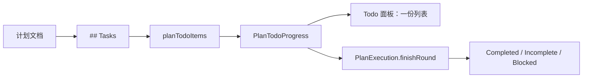
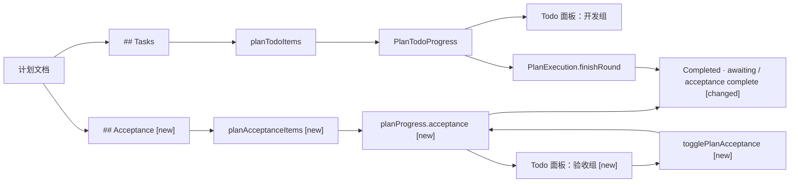
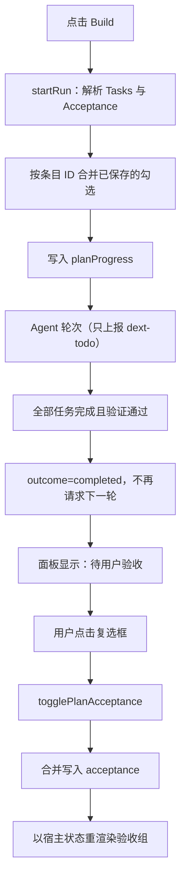

# Design

## Context

Plan 进度目前是一条链，从头到尾只认一份列表：

- `planTodoItems(document)` 扫描 `## Tasks`（识别围栏代码块，`###` 阶段标题作为 `group` 保留），产出 `plan-<n>` 形式的 ID。
- `PlanTodoProgress.consume` 只接受 ID 存在于该列表中的 `dext-todo` 上报；任何一条未知 ID 会让整条上报被原子丢弃，同一个 comment 里的其他更新也一并作废。
- `PlanExecution.finishRound` 用同一份列表加 `progress.verified` 判定 `completed` / `incomplete` / `blocked`；`verifying` 只是“全部任务已完成”的同义词。
- `PlanController.startRun` 从计划文档播种任务列表，并通过 `resumePlanTodos` 按位置 ID 合并旧状态（来自 `session.planProgress` 或最后一个计划回合的 `phase: "todo"` 事件）。
- `PlanController.saveProgress` 整体赋值 `session.planProgress = { path, todos }`，经 `ConversationHistoryStore.updatePlanProgress` 写入。`turnExecutionCoordinator` 在每轮结束和失败收尾各调用一次。
- `PlanController.settle` 在 `completed` 时执行 `delete session.activePlanPath`，只保留 `session.planProgress`。
- 面板是 `AgentTodoView`（实时）加 `renderAgentTodos`（静态历史），共用 `agentTodoRows` / `agentTodoProgress`。

现有链路容不下“由人负责的检查”：`finishRound` 会把未勾选的人工项当作未完成的 Agent 工作，`consume` 会拒绝一切它不认识的 ID。因此本设计新增一条平行列表，而不是复用任务 ID。

## Goals / Non-Goals

**Goals:**

- 文档、解析、面板、计数、持久化五处都把开发任务与用户验收分开。
- 验收只能由用户改变，且以最小改动复用现有 `planProgress` 持久化路径。
- 完成判定保持只看开发工作；续跑、恢复、开发任务 ID 全部不变。
- 没有 `## Acceptance` 的旧计划零迁移、零行为变化。

**Non-Goals:**

- 迁移历史计划文件，或重新标注历史上已记为 blocked 的任务。
- 在 History 页面提供验收勾选（History 只读）。
- 用户报告验收失败后自动启动修复轮次。
- 把 `## Verification` 改造成人工步骤表。

## Decisions

| 决策 | 选择 | 理由 |
| --- | --- | --- |
| 验收状态存放位置 | `session.planProgress.acceptance`，复用 `updatePlanProgress` | 该记录已按会话持久化并随标签页恢复；新建存储会复制整套生命周期并多一个失败点 |
| 条目身份 | `accept-<hash>`，hash 取自归一化文本（去首尾空白、折叠空白、忽略大小写）；文本相同的条目按出现顺序追加 `-2`、`-3` | 重排与插入不会搬走别人的勾选；改写条目则有意重置为未勾选，因为那是另一条要求 |
| 写入语义 | `updatePlanProgress(sessionId, path, todos, acceptance?)` 的 `acceptance` 是“仅在提供时替换”，未提供时保留已存值 | 协调器每轮只写 todos，若整体替换会把运行期间勾选的验收抹掉 |
| 计划控制器合并 | `saveProgress` 写入时保留 `session.planProgress` 中同路径的 `acceptance` | 与上一行形成双层保护：任一层单独漏改都不会丢数据 |
| 勾选校验对象 | 校验 `session.planProgress?.path === planPath`，而不是 `activePlanPath` | `settle` 在 `completed` 时删除 `activePlanPath`，而“计划已完成、等用户验收”恰恰是最主要的勾选时刻 |
| 变更通道 | 新增 `togglePlanAcceptance` 请求与 `planAcceptance` 响应 | 用户路径显式且可校验；`dext-todo` 的载荷与解析器完全不动，Agent 上报无法寻址验收 ID |
| 完成判定 | `PlanExecution.finishRound` 与 `verifying` 不改，只在表现层加标签 | 验收绝不能阻断或续跑，且历史存下来的 `planOutcome` 语义保持可比 |
| 标签计算 | `planExecutionLabel(events, error, outcome, acceptance?)` 输出 `Completed · awaiting acceptance` / `Completed · acceptance complete`，无验收时仍是 `Completed` | 一个函数已经同时供给实时、恢复与静态历史三处，不会各写一套措辞 |
| 验收组渲染 | 与开发组同在一个 Todo 面板内，但作为独立 `<section>` 常驻展示，不用 `
` 折叠 | 需求要求复选框直接可见；折叠会把唯一可点的控件藏起来 |
| 显示在哪一回合 | 只有该计划的最新回合显示验收组，`planPath` 匹配 `planProgress.path` 的最后一个回合之外一律隐藏 | 同一计划的 Build 回合与多次续跑回合会有多块 Todo 面板，逐块显示会给出多份互相矛盾的勾选框 |
| History 页面 | 复用同一个渲染器，但复选框 `disabled` | 一个 HTML 构建器同时服务实时与历史，两边不会漂移；History 保持只读，不新增宿主写入入口 |
| 章节扫描 | 在 `planTodoProgress.ts` 内新增独立的 `planAcceptanceItems`，不改动 `planTodoItems` | `planTodoItems` 是每轮都会跑的热路径，为复用而重构成公共辅助函数属于无收益风险 |

## Before / After

Before：一份列表决定一切。

After：两条列表，唯一的汇合点是回合标签。

开发路径（Tasks → `PlanTodoProgress` → `finishRound`）在改动后完全不变，因此续跑、恢复与停滞检测保持现有行为。

| 区域 | 改动前 | 改动后 | 文件 |
| --- | --- | --- | --- |
| 文档 | Tasks + Verification | 增加 Acceptance | `planTemplate.ts`、`docs/workflows*.md` |
| 解析 | 只有 `planTodoItems` | 增加 `planAcceptanceItems`，文本派生 ID | `planTodoProgress.ts`、`planAcceptance.ts`（新） |
| 持久化 | `planProgress.todos` | 增加 `planProgress.acceptance`，合并写入 | `contracts/history.ts`、`historyStore.ts`、`conversationController.ts`、`contracts/execution.ts`、`app/conversationSetup.ts` |
| 面板 | 一份列表，无输入控件 | 开发组 + 验收组，带复选框 | `agentTodoPresentation.ts`、`agentTodoView.ts`、`historyRender.ts`、`transcriptView.ts`、`webview/main.ts`、`media/styles.css` |
| 消息 | 只有计划上下文 | 增加 `togglePlanAcceptance` / `planAcceptance` | `contracts/protocol.ts`、`sidebarProvider.ts`、`planController.ts` |
| 完成标签 | `Completed` | `Completed · awaiting acceptance` / `Completed · acceptance complete` | `agentTodoPresentation.ts` |

## Execution flow

轮次在任何验收交互之前就以 `completed` 停止；用户的点击只会重新进入持久化这一步，绝不会重新进入执行。

## Risks / Trade-offs

| 风险 | 影响 | 缓解 |
| --- | --- | --- |
| 旧回合快照里的验收状态与当前会话不一致 | 重载后出现过期勾选 | 渲染时以会话 `planProgress.acceptance` 为准，回合快照只作回退 |
| 每次重渲染都替换 DOM，键盘用户丢失焦点 | 无障碍回退 | 渲染后按 `data-acceptance-id` 把焦点还给刚切换的复选框 |
| 验收文本按 Markdown 渲染可能带入恶意 HTML 或链接 | 面板注入 | 复用 `todoMarkdown`（原始 HTML 与 `javascript:` 链接已失效），属性值一律 `escapeHtml` |
| 验收列表很长，把开发组挤上去 | 可读性 | 验收组有自己的计数头部，条目行保持单行高度并允许换行，不折叠 |
| 后续有人"优化" `finishRound` 让它等待验收 | 计划静默卡死 | `test/planExecution.test.ts` 锁定：存在未勾选验收时仍返回 `completed` 且不请求新一轮 |
| 协调器每轮只写 todos，顺手整体替换 | 运行期间勾选被抹掉 | `updatePlanProgress` 与 `saveProgress` 双层合并，并有专门测试 |
| 面板有多块，只更新了当前回合 | 同一计划的旧回合显示过期勾选 | `planAcceptance` 响应携带 `sessionId` 与 `planPath`，Webview 按路径刷新所有可见的匹配回合 |

回滚方式：还原上表列出的文件即可。`planProgress.acceptance` 是纯增量字段，旧版本代码会忽略它，不需要数据迁移。

## Migration Plan

无。旧计划没有 `## Acceptance`，解析结果为空，验收组自动隐藏；历史回合的 `planOutcome` 保持原值。不重写任何历史计划，也不重新标注历史上已记为 blocked 的任务。

## Open Questions

无阻塞项。History 页面是否允许勾选验收已明确列为不做，若将来需要，应作为一个独立的变更处理。
