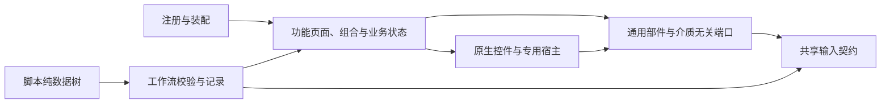

# Design

## Context

盘点基于当前 HEAD `acba6bd`。用户指出的 `openspec/changes/unify-ui-primitives` 已随 `b09cb29` 归档。该提交落地了共享 `UiRenderAdapter`、`MarkupAdapter`、Trace、原生控件和只读 `ui.render`，并把两份增量合入主规格。旧设计提到的 `TurnRenderAdapter` 是历史名称，当前通用契约已经位于 `shared/lib/ui/renderAdapter.ts`。回合专用 `TurnResultAdapter` 仍承载文件链接等上下文。当前模型子菜单依然执行 `positionModelSubmenu`，因此以当前夹取及右、左、上回退作为基线。[前序设计](../archive/2026-11-20-unify-ui-primitives/design.md) · [前序任务](../archive/2026-11-20-unify-ui-primitives/tasks.md) · [渲染契约](../../../src/shared/lib/ui/renderAdapter.ts) · [回合输出](../../../src/features/conversations/presentation/turnComponents.ts) · [模型菜单](../../../src/webview/main.ts#L1339)

当前注册入口包括一个侧栏 Webview、Resources 编辑器 Webview 及其恢复序列化器、独立 History 面板、草稿预览、按附件复用的图像／视频标注面板，以及运行时视频帧提取面板。History 当前直接由 `DextHistoryPanel` 管理，Resources 经过 `EditorTabManager`。API Reference 是 Resources 的 Dext 页及详情分支。图像和视频标注共享一个 view type，按附件类型加载不同入口。表中同时列出侧栏子界面、专用绘制和 VS Code 原生入口。[package.json](../../../package.json#L777) · [激活与注册](../../../src/extension.ts#L319) · [History 面板](../../../src/features/conversations/host/historyEditorProvider.ts#L29) · [侧栏与预览](../../../src/app/sidebarProvider.ts#L386) · [媒体标注](../../../src/features/conversations/host/imageAnnotatorPanel.ts#L61) · [帧提取入口](../../../src/app/application.ts#L1877)

当前通用部件的结构和样式所有权仍有脱节。`traceComponents.ts` 同时承载过程、普通内容与 Markdown，脚本视图通过 `agent-result-*` 和 `agent-todo-status` 获得默认样式。Tabs 与 Menu 的较通用 DOM 逻辑仍处于 Conversation browser，表单壳与字段分布于 Conversation 与侧栏模板。Resources 也已经实际使用 Button、Alert 和 Trace，并保有独立文档壳、控件、签名与源码标记。主规格 `conversation-view-components`、`plan-acceptance` 的行为继续作为门槛。本次扩展的是 `script-view-output` 内旧节点封闭清单，已有节点和已保留名称继续有效。[脚本视图](../../../src/shared/lib/ui/uiViewPresentation.ts) · [资源展示](../../../src/features/resources/presentation/resourceDocuments.ts) · [会话规格](../../specs/conversation-view-components/spec.md) · [验收规格](../../specs/plan-acceptance/spec.md)

设计采用 shadcn/ui 的源码所有权、可组合接口、部件树和默认值记录方式，并参考 Ant Design 将组件按场景分组及区分基础部件和业务模块。Dext 保持当前 TypeScript、原生控件、依赖和 VS Code 主题能力。[shadcn/ui](https://ui.shadcn.com/docs) · [部件组合](https://ui.shadcn.com/docs/changelog/2026-04-component-composition) · [Ant Design 设计概览](https://ant.design/docs/spec/overview-cn/) · [组件总览](https://ant.design/components/overview-cn/)

## Goals / Non-Goals

**Goals:** 让任一自带界面可以从注册入口追到基础组件或专用宿主，让公共节点可以反向追到自带界面的同一份实现。使用可比对的 DOM／HTML 结构及正常入口样例建立迁移门槛。

**Non-Goals:** 交付范围止于只读树和现有表单交互。主题 SDK、脚本独立面板和内容内动作属于后续能力。原生 VS Code 界面、Monaco、Mermaid、媒体渲染及其专用生命周期继续由宿主负责。

## Decisions

### 全局基础层、组合与适配

沿用仓库已存在的 `shared`、`features`、`platform` 和 `app` 分层。通用组件及其结构、属性、状态语义和样式由基础层维护。可复用界面组合为真实使用场景排列基础组件，例如回合的 Process、表单的对话框或资源文档的标题与示例。页面解释业务数据、持有业务状态、发出动作并持久化。平台层实现具体介质和通用原生绑定，应用组合根负责入口注册和装配。[仓库层级约定](../../../docs/development.zh-CN.md) · [边界检查](../../../scripts/checkModuleBoundaries.mjs)

```text
src/
├── shared/
│   ├── contracts/
│   │   ├── uiView.ts                 # 只读节点与结果契约
│   │   └── uiForm.ts                 # 既有表单与答案契约
│   └── lib/ui/
│       ├── renderAdapter.ts          # 介质无关的构建端口
│       ├── htmlUiAdapter.ts          # 纯字符串适配器
│       ├── layout/                   # Stack、Inline、Section、Toolbar
│       ├── navigation/               # Tabs、Menu 的结构和状态
│       ├── input/                    # Form、Field、Label 和原生控件标记
│       ├── content/                  # 普通内容、Disclosure、Trace
│       ├── feedback/                 # Badge、Spinner、Alert、Empty
│       ├── overlay/                  # Dialog 的可组合外壳
│       └── uiViewPresentation.ts     # 公开节点映射和纯文本输出
├── platform/
│   ├── browser/                     # DOM、原生绑定、Markdown 图表
│   ├── editor-tabs/                 # 编辑器标签壳、身份和恢复
│   └── vscode/                      # 原生选择、通知、编辑器和打开资源
├── features/                        # 会话、资源、工作区等页面与状态
├── webview/                         # 侧栏装配及 Monaco 接入
├── app/                             # 宿主装配和侧栏外壳
└── runner/                          # 工作流序列化、调用和重放
media/ui.css                          # 共享组件的样式与主题变量
media/{styles,editorTabs,appearance}.css  # 页面布局与已有主题桥
```



特性展示层直接导入具体共享定义，由入口传入适配器。复用 `element` 和 `markup`，只让受信 Markdown 或高亮器提供受限标记。`htmlUiAdapter` 转义文本、维护 void 元素和布尔属性，`domUiAdapter(document)` 通过所属文档构建元素。原生事件绑定留在 browser 或专用宿主。新增自动检查禁止 shared UI 读取 `document` 或 Conversation 类型。也评估过将组件作为新顶层 feature 或维护各页面渲染器。现有共享内核允许浏览器、宿主和 runner 数据契约消费，不会增加跨 feature 实现依赖或复制 HTML 与 DOM 结构。

公共主题变量从现有颜色和字体规则提炼。组件接管默认间距、可访问状态及其样式，页面控制容器尺寸、裁切、滚动和有证据的兼容变体。迁移时保留当前类名、id、data 属性和首帧主题，先跑同输入的浏览器对照，再移走属共同部件的 CSS。`media/ui.css` 在有样式的 Dext 文档内只加载一次，构建验证相对路径、CSP、本地资源和 VSIX 资产。历史结构仍用只读模式，Resources HTML 页虽由宿主出图，现有 DOM 客户端仍绑定按钮与搜索；“HTML 介质”本身不决定是否可交互。

### 全量界面迁移表

表中测试列给出当前源码可用的基线，标为“补”的检查属于实施任务。脚本名默认位于 `scripts/`，`*.test.ts` 位于 `test/`。阶段 4 是三条代表路径，阶段 5 按入口扩展。已复用栏中的样式复用仅说明 CSS 消费情况。

| 入口／界面 | 渲染介质与源码证据 | 已复用与独立构建 | 关键行为与测试基线 | 目标入口与页面职责 |
| --- | --- | --- | --- | --- |
| `dext.sidebar` 外壳、会话标签与页面切换 | 宿主模板 + DOM，[sidebarProvider.ts](../../../src/app/sidebarProvider.ts#L1524)、[conversationTabs.ts](../../../src/features/conversations/browser/conversationTabs.ts)、[main.ts](../../../src/webview/main.ts) | Button、Spinner、TraceIcon、选中态写入；外壳、tablist、拖拽和视图缓存各自持有 | 新建／切换／固定／重排／关闭、活动状态、窄宽滚动、恢复焦点与草稿；`checkConversationTabsUi.mjs`、`conversationTabOrder.test.ts` | 5.1 由 `DextSidebarProvider.html` 和 `renderConversationTabs` 接 Stack、Tabs、Button、Spinner。会话管理保留缓存、排序、拖拽和动作 |
| Composer 编辑器、提示、附件、排队及折叠 | HTML 外壳 + DOM + Monaco，[sidebarProvider.ts](../../../src/app/sidebarProvider.ts#L1588)、[codeEditor.ts](../../../src/webview/codeEditor.ts)、[imageAttachments.ts](../../../src/webview/imageAttachments.ts)、[queuedTurn.ts](../../../src/features/conversations/browser/queuedTurn.ts) | 引用芯片、文件拖放、Monaco 能力已有共享；发送、折叠、诊断、错误、附件条、排队 UI 仍局部构建 | Code 补全和诊断、IME、粘贴、Shift 拖放、草稿、排队编辑／撤回、附件打开与删除；`checkComposerLayoutUi.mjs`、`checkComposerImeUi.mjs`、`checkMonacoInputUi.mjs`、`codeEditorFileDrop.test.ts` | 5.1 Composer 组合 Toolbar、Button、Alert、Badge、Inline。Monaco 接入保留 model URI、草稿和编辑生命周期，页面决定发送和引用。聊天模式取消 `@` 文件候选并移除 `@ for files` 提示，手写 `@path`、附件、拖放、粘贴及 Enter／Shift+Enter 行为继续保留 |
| Composer 模式、Skills、Permission、Agent、Model 及更多菜单 | HTML 壳 + DOM，[composerMenu.ts](../../../src/features/conversations/browser/composerMenu.ts)、[main.ts](../../../src/webview/main.ts#L968)、[composerOverflow.ts](../../../src/features/conversations/browser/composerOverflow.ts) | 部分选项已用 Button 和 TraceIcon／Title。焦点辅助已在 Composer 抽出，触发器和模型定位仍独立 | 方向键/Home/End、停用项、Escape、模型三向回退、Skills pack 三态和溢出；`checkComposerLayoutUi.mjs`、`checkResourceUi.mjs` | 5.1 各既有菜单渲染器接 Menu 和通用键盘绑定。Composer 保留模式、模型、插件、预设、技能和权限回调及裁切空间 |
| Plan／资源制作工具栏与资源来源分段 | HTML + DOM，[main.ts](../../../src/webview/main.ts#L864)、[planControls.ts](../../../src/features/conversations/browser/planControls.ts)、[sidebarProvider.ts](../../../src/app/sidebarProvider.ts#L1566) | 使用 `setTabSelected`；目标、状态、Build／Save／Preview 及入口条件仍独立 | 保留选文件、创建、保存重试、Build/Stop、Describe/Import、草稿和请求归属；`checkResourceUi.mjs`、`resourceConversation.test.ts`、`planCodeApiSave.test.ts` | 5.1 `renderPlanToolbar`、`renderResourceToolbar`、`renderResourceSource` 接 Toolbar、Tabs、Badge、Button；选择资源/计划仍由宿主指派 |
| Plan Todo、用户验收和 Process | DOM + 历史 HTML，[agentTodoView.ts](../../../src/features/conversations/browser/agentTodoView.ts)、[agentTraceView.ts](../../../src/features/conversations/browser/agentTraceView.ts)、[agentTodoPresentation.ts](../../../src/features/conversations/presentation/agentTodoPresentation.ts) | 八个 Trace 部件、Checkbox、徽标和计数已复用；事件聚合、承载壳、滚动与流式刷新独立 | 任务与验收独立计数、持久勾选/回焦、工具组、流式顺序和中断回放；`agentTodos.test.ts`、`planTurnHydration.test.ts`、`checkStructuredOutputUi.mjs` | 4.1／5.2 `buildAgentTodoSection`、`AgentTraceView` 接全局 Trace、Badge、CodeBlock 和原生绑定。状态、审批、事件 id 及计数留在会话层 |
| 回合与 Output，包括流式 Markdown、结构化结果、复制、文件变更、导航与恢复 | DOM + 历史 HTML，[transcriptView.ts](../../../src/features/conversations/browser/transcriptView.ts)、[turnComponents.ts](../../../src/features/conversations/presentation/turnComponents.ts)、[main.ts](../../../src/webview/main.ts#L1597) | 共享回合壳、披露、Markdown、代码与 view 节点已有入口；跳转、变更行、流式更新、复制透传仍由页面控制 | 原文复制、JSON 和失败/中止已产出内容、引用/差异、流式滚动和恢复；`turnComponents.test.ts`、`historyRender.test.ts`、`checkConversationScrollUi.mjs`、`checkStreamJumpUi.mjs`、`checkPatchApplicationUi.mjs` | 4.1／5.2 `TranscriptView` 与 `renderTurnResult` 接 Content、Disclosure、CodeBlock、Stack 与 Alert。复制原文、链接、补丁及滚动留宿主 |
| 用户应答、权限与工作流表单 | 侧栏静态 Dialog + 实时 DOM；历史 HTML 摘要，[agentInputView.ts](../../../src/features/conversations/browser/agentInputView.ts)、[interactionForm.ts](../../../src/features/conversations/browser/interactionForm.ts)、[interactionDialog.ts](../../../src/features/conversations/browser/interactionDialog.ts)、[main.ts](../../../src/webview/main.ts#L786) | Button、Alert、Checkbox、Radio、Label；inline 卡、模态壳、多型字段、引用控件与旧权限提示仍按入口装配 | Select、原生校验、拖放、秘密值、全屏 Escape 次序、关闭恢复、答复 id 和只答一次；`uiForm.test.ts`、`uiInteractionBroker.test.ts`、`conversationProtocol.test.ts`、`checkInteractionUi.mjs`、`checkQuestionVisibilityUi.mjs` | 5.2 `AgentInputView`、`InteractionForm` 与权限提示接 Dialog、Form、Field、Input、Select、Alert；请求协调、草稿、敏感字段与答案摘要保留 |
| 侧栏 MCP Assistant | 侧栏静态 Dialog + DOM，[sidebarProvider.ts](../../../src/app/sidebarProvider.ts#L1637)、[mcpAssistantView.ts](../../../src/webview/mcpAssistantView.ts) | 使用对话框既有 CSS，独立构建说明、Process、配置编辑、工具列表、状态、范围及保存 | 生成、运行时状态、复核、关闭确认、保存作用域及按原协议通信；`sidebarLayout.test.ts` 与 `checkComposerLayoutUi.mjs`，补生成／取消／保存的桥接夹具 | 5.2 `McpAssistantView` 接 Dialog、Form、Textarea、Select、Disclosure、Alert。输入与配置草稿、生成和保存仍由 MCP 功能负责 |

#### 编辑器标签、预览及宿主界面

| 入口／界面 | 渲染介质与源码证据 | 已复用与独立构建 | 关键行为与测试基线 | 目标入口与页面职责 |
| --- | --- | --- | --- | --- |
| `dext.openHistory` → `dext.history` | 宿主 HTML + 内联客户端，[historyEditorProvider.ts](../../../src/features/conversations/host/historyEditorProvider.ts)、[historyRender.ts](../../../src/features/conversations/presentation/historyRender.ts) | 共享回合结果、Trace、Todo 和 Markdown 图表；历史框架、搜索、懒加载和上下文导航独立 | 筛选/收藏/归档、正文搜索、懒载、重命名、复制、继续/分支、键盘文件链接；`historyEditorProvider.test.ts`、`historyRender.test.ts` | 5.3 `DextHistoryPanel` 与 `renderHistorySession` 接 Stack、Toolbar、Input、Empty、Disclosure。History 保有存储、搜索合并、动作映射与懒载，独立面板生命周期保留 |
| `dext.viewResources` → `dext.globalResources` 的 Project、Global 和 Dext 列表 | HTML + 客户端脚本，`ResourceBrowserProvider.showList` / serializer，[resourceBrowserProvider.ts](../../../src/features/resources/host/resourceBrowserProvider.ts)、[editorTabHtml.ts](../../../src/platform/editor-tabs/editorTabHtml.ts)、[resourceDocuments.ts](../../../src/features/resources/presentation/resourceDocuments.ts#L518) | 已用 Button、Trace 折叠、共享 editor tab 壳；搜索、导览、分组和 pack 控件分支独立 | 恢复稳定 key、作用域、查询、展开、刷新、资源创建/可见性/Skill pack 行为；`globalResourcesPanel.test.ts`、`resourceEditorProvider.test.ts`、`editorTabSerializer.test.ts`、`checkEditorTabsUi.mjs` | 5.3 `renderResourceList` 接 Tabs／链接导航、Disclosure、Toolbar、Input、Empty。保留文档分类、安装／可见性、恢复与动作协议 |
| Project/Global 资源详情与恢复错误 | HTML + DOM，`ResourceBrowserProvider.showDetail`，[resourceDocuments.ts](../../../src/features/resources/presentation/resourceDocuments.ts#L547)、[恢复分支](../../../src/extension.ts#L333) | Button、Alert；标题、来源跳转、文档、源码与错误恢复各自拼接 | 打开源文件、编辑、插入引用、删除后仍可恢复刷新、过滤状态；`resourceDocuments.test.ts`、`resourceEditorProvider.test.ts`、`checkEditorTabsUi.mjs` | 5.3 `renderResourceDefinition` / `renderResourceError` 接 Section、Code、CodeBlock、Alert、Button；来源、操作权限与恢复保留 |
| Resources 的 Dext 页 → API、类型及 Node／JavaScript Reference 详情 | HTML + DOM，`renderApiList` / `renderApiDetail`，[apiPanel.ts](../../../src/features/resources/presentation/apiPanel.ts)、[类型和参考成员](../../../src/features/resources/presentation/resourceDocuments.ts#L568)、[apiReference.ts](../../../src/features/workflow/host/apiReference.ts) | 复用资源导航和 Button；签名、参数、示例、Types 列表与 API 流程独立 | 静态签名、默认参数、递归文档/类型、复制说明与流程图按需加载；`apiPanel.test.ts`、`apiReference.test.ts`、`checkEditorTabsUi.mjs` | 4.2／5.3 `renderResourceDefinition`、`renderReferenceMember` 接 Section、Code、CodeBlock、Badge。目录、静态分析、复制与数据含义留功能层 |
| Composer 资源草稿 Preview → `dext.resourcePreview` | HTML，`previewResource` / `previewHtml`，[sidebarProvider.ts](../../../src/app/sidebarProvider.ts#L386)、[renderResourcePreview](../../../src/features/resources/presentation/resourceDocuments.ts#L652) | 共用 editor tab 壳、资源视觉及高亮；独立标题、Draft 标识、多文件源码段。当前主题选择为打开时快照 | 草稿、辅文件顺序、代码实体和流程先于源码、只读与既有打开列；`resourceDocuments.test.ts`、`checkResourceUi.mjs`，补实际预览面板模板断言 | 5.3 `renderResourcePreview` 接 Section、Badge、CodeBlock；保留独立只读 panel、资源快照、流程图入口与主题时机 |
| 图像标注 → `dext.imageAnnotator` | DOM、图像／画布，[imageAnnotatorPanel.ts](../../../src/features/conversations/host/imageAnnotatorPanel.ts#L190)、[imageAnnotatorPage.ts](../../../src/features/conversations/browser/imageAnnotatorPage.ts)、[imageAnnotator.ts](../../../src/features/conversations/browser/imageAnnotator.ts) | 复用侧栏样式；工具栏、错误、列表、批注、图层与画布独立构建 | 原图坐标、缩放、指针与框选、备注、回填、重开恢复；`imageAnnotation.test.ts`、`imageAnnotatorPanel.test.ts`、`checkImageAnnotatorUi.mjs` | 5.4 annotator 页外围用 Toolbar、Button、Badge、Textarea、Empty、Alert。图像加载、画布、指针捕获、保存与回填留媒体端口 |
| 视频标注 → `dext.imageAnnotator` 视频分支 | DOM、原生 video／画布，[videoAnnotatorPage.ts](../../../src/features/conversations/browser/videoAnnotatorPage.ts)、[videoAnnotator.ts](../../../src/features/conversations/browser/videoAnnotator.ts)、[videoPlayback.ts](../../../src/features/conversations/host/videoPlayback.ts) | 复用图像标注样式与坐标模型；播放、时间轴、分帧工具、进度和行仍独立构建 | 播放/定位、帧备注、转换错误或重试、导出次序和回填；`videoAnnotation.test.ts`、`videoPlayback.test.ts`、`imageAnnotatorPanel.test.ts`，补视频浏览器夹具 | 5.4 `VideoAnnotator` 外围用 Toolbar、Button、Textarea、Badge、Alert、Spinner。原生媒体、解码/转码、存储、时间轴和帧导出留专用适配 |
| Agent 视频帧工具 → `FramesBridge` → `dext.videoFrames` | 短生命周期 HTML + video／canvas，[videoFrames.ts](../../../src/features/conversations/host/videoFrames.ts)、[videoFramesPage.ts](../../../src/features/conversations/browser/videoFramesPage.ts) | 专用 CSP、脚本、捕帧及消息壳；当前无业务控件 | 保留焦点、顺序、尺寸、错误/超时和关页；`videoPlayback.test.ts`、`framesBridge.test.ts` 和 `framesMcp.test.ts`，补面板与媒体生命周期夹具 | 5.4 记录 `VideoFrames.capture` 的专用适配入口，保留无外观的宿主壳。宿主清理计时器、监听和媒体对象 |
| Markdown/Mermaid 与 API 执行流程 | Markdown HTML、浏览器 SVG，[markdownDiagrams.ts](../../../src/platform/browser/markdownDiagrams.ts)、[diagrams.ts](../../../src/webview/diagrams.ts)、[apiFlow.ts](../../../src/features/resources/browser/apiFlow.ts) | 共用 Mermaid 队列/主题/安全选项；触发、维护面板容器与错误是功能组合 | 保持惰性加载、首帧主题、错误和原有链接策略；`checkStructuredOutputUi.mjs`、`checkEditorTabsUi.mjs`、`assertWebviewAssets.mjs` | 5.2／5.3 Markdown 和 Section 接同一渲染定义，继续用既有图表适配。API 流程保留数据解释、展开与图表资源 |
| VS Code 原生按钮、命令和外壳 | `package.json` 的 view/title、editor/title、上下文与配置，`extension.ts` 的 commands、QuickPick、InputBox、通知、Diff、打开源文件，侧栏的 Dext Input 输出通道与 [selectionActions.ts](../../../src/platform/vscode/selectionActions.ts) hover | VS Code 控件由 Workbench 绘制；Dext 提供命令、文本、状态、选择和回调 | 命令可用性、Workspace Trust、原生焦点、阻止误确认、剪贴板、文件/差异打开及编辑器选择；`vscodeSelectionActions.test.ts`、`historyEditorProvider.test.ts`，补原生调用录制夹具 | 5.5 以原生适配记录入口与业务回调。保留 Workbench 挂载、主题、焦点和订阅释放，Dext 交给原生 API 处理 |

### 组件目录与渲染约定

“H/D” 表示共享定义适配 HTML 和 DOM，“D” 表示需要活的 DOM 才能操作。HTML 可以输出初始化结构。交互部件的程序状态先由宿主传入，连接后使用原生属性同步。公开字段和内部宿主选项经不同类型暴露，公开树无法传入 CSS、任意 DOM 属性与回调。

| 分类／组件 | 目录结论与消费者 | 属性、默认值与合法内容 | 介质、a11y 与宿主 | 公开 |
| --- | --- | --- | --- | --- |
| 布局 · Stack | 补齐；回合块、History、资源详情、脚本报告 | `gap: "sm" / "md" / "lg"`，默认 `"md"`；纵向，接普通块或内置页面槽 | H/D；文档顺序，按容器宽度收缩，无绑定 | `UiStack` |
| 布局 · Inline | 补齐；资源元信息、回合状态、脚本摘要 | `gap` 默认 `"sm"`，`wrap` 默认 `true`；接普通内容，复杂块仍保序 | H/D；窄栏换行，以 DOM 顺序朗读，显式不换行时容器允许横向滚动，无绑定 | `UiInline` |
| 布局 · Section | 补齐；回合片段、资源文档、API 示例、报告 | 必填非空 `title`，可选纯文本 `description`，随后为内容；内部入口可明确指定标题级别 | H/D；原生 section 和 heading，公开报告第一层 h3，嵌套逐级递增至 h6，Stack/Inline 不增加级别 | `UiSection` |
| 布局 · Toolbar | 合并；Composer、History、资源、媒体工具栏 | `label`、`children`；沿用宿主当前顺序和换行，接按钮、菜单触发器、搜索等 | H/D；具名区域，已有工具栏角色和按键按宿主合同保留，无统一焦点接管 | 内部 |
| 导航 · Tabs | 补齐；会话标签、资源分段、编辑器页导览 | `label`、`selected`、`disabled=false`；TabList、Tab、可选 Panel，关闭/固定动作为 Tab 同级 | H/D 标记、D 绑定；维护 role、可访问名和 aria-selected，关联实际受控区域。真实链接保留导航语义；业务决定选中和拖拽 | 内部 |
| 导航 · Menu | 合并；Composer 的模式、模型、技能、权限、预设和更多菜单 | 触发器默认收起；项含 label、checked、disabled、可选分组/子菜单；Empty 只显示说明 | H/D 标记、D 绑定；现有 ↑↓、Home/End、左右层级、Escape、选中和回焦；宿主保有裁切容器及动作 | 内部 |
| 输入 · Form | 合并；现有工作流、Agent 表单和 MCP 助手 | `title`、可选 description、Field／组、Error、Actions；表单语义一次提交，沿用隐式动作与默认必填规则 | H/D 标记、D 交互；共享名称、提示、错误和动作状态；宿主验证、收集并提交结果 | `ui.form` 的参数与答案 |
| 输入 · Field、Label、Description、FieldError | 补齐；交互表单、MCP 配置、标注备注、验收标签 | 字段 label 必填，单字段一个控件或一组同契约选项；可选 description、error；`required` 在公开表单默认 true | H/D 标记；单控件用 for/id 或既有具名机制，组用 fieldset/legend。说明和错误保持可读关联，实时错误沿用既有播报 | `UiField` 数据 |
| 输入 · Input、Textarea | 合并；Form、History 与资源搜索、MCP、图像／视频备注 | `value` 默认空字符串、可选 placeholder/disabled；Input 选择 text/search/password，Textarea 保留多行；均为叶 | H/D 标记、D 可编辑；原生 label、焦点与选择。草稿、验证、secret、引用、拖放由各入口处理 | `ui.input` 和表单 input 字段 |
| 输入 · Select | 复用并上移；交互表单，MCP 原生 scope 使用同语义的原生变体 | `options`、`selected`、`multiple=false`、label、placeholder；Trigger 加 listbox/Option，原生变体用 select/option | D 行为；具名、`aria-expanded`、`aria-selected`，保留 manual popover 及失焦/Escape 顺序；宿主验证所选值 | `ui.select` 和表单 select 字段 |
| 输入 · Radio、Checkbox | 复用；表单选择组、Plan 验收、资源三态按钮按既有角色呈现 | `checked=false`、`disabled=false`、id、组名与 Label；历史显示值随状态，资源三态由页面给出 | H/D 标记、D 操作；原生 Radio 组、Checkbox Space 与 label 点击；宿主保存并回焦 | `ui.radio`、`ui.checkbox` 和表单字段 |
| 输入 · Button | 复用；全部页面工具栏、菜单、标签和表单 | `type="button"`、`disabled=false`、label/具名图标，内部变体可作提交；接文本和图标 | H/D；禁用用原生属性，图标须有名称，宿主注入动作 | 表单动作数据，显示树内无动作 |
| 覆盖层 · Dialog | 合并；工作流 Dialog、旧权限提示、MCP Assistant | `open=false`、必需可访问标题。可选 Description、关闭/全屏动作、内容、页脚；可放一个 Form | H/D 壳、D 原生 `showModal`；背景 inert、模态焦点范围、分层 Escape 与焦点恢复，业务取消由宿主映射 | 由现有 `presentation` 调用 |
| 覆盖层 · Tooltip、Popover、Drawer | 延期新增组件；Composer 的描述 tooltip、Select 的原生 popover 都有当前宿主 | 延用 title 与 Select/Menu 既有锚点、开闭和默认值。Drawer 暂无迁移消费者 | D；说明或弹层行为按对应现有入口维护 | 保留名称 |

#### 内容展示与反馈

| 分类／组件 | 目录结论与消费者 | 属性、默认值与合法内容 | 介质、a11y 与宿主 | 公开 |
| --- | --- | --- | --- | --- |
| 内容 · Text / Markdown | 拆出复用；回合、资源说明、报告 | `Text.text`、可选 tone，默认 normal；`Markdown.source` 必填，内部宿主可选择受信链接与现有复制策略。两个均无 children | H/D；文本转义，段落、标题等保留语义。脚本 Markdown 仅保留可读文字和安全标记，文件/链接/图表由对应宿主处理 | `UiText`、`UiMarkdown` |
| 内容 · Code / CodeBlock / Separator | 拆出复用；回合 JSON、Agent 命令、资源源码与 API 示例、报告 | `Code.text`、`CodeBlock.code` 必填；Separator 无字段。内置 CodeBlock 可以接受受信高亮并由宿主提供复制区 | H/D；code、pre/code、hr。脚本 CodeBlock 的既有原生复制按钮保持禁用。内置输出可复制原文 | `UiCode`、`UiCodeBlock`、`UiSeparator` |
| 内容 · Disclosure | 合并；History、资源分组、回合、MCP Process | `open=false`，各场景保留所传初始状态。具名 Trigger 后接 Content；允许内部合法摘要动作 | H/D；原生 details/summary 和键盘披露，宿主控制历史懒载、树展开、权限与滚动 | 内部 |
| 内容 · Trace / TraceLine | 复用；Todo、验收、Agent Trace、部分资源树、脚本过程 | `ordered=false`；Trace 的公开子项仅 TraceLine，行可接既有内容和嵌套 Trace。行 `status` 缺省无状态，`tone` 缺省 normal | H/D；保留列表语义和状态文字，内置可结合 Disclosure、Checkbox 和绑定 | `UiTrace`、`UiTraceLine` |
| 内容 · TraceIcon / TraceTitle / TraceDescription | 复用；过程行、Todo 和历史；通用图标从现有 Codicon 标记提取 | `icon` 必需且使用现有白名单；标题和描述的 `text` 必需，描述的 `tone` 默认 normal；公开为叶 | H/D；装饰图标隐于辅助技术；标题可为披露具名；实时计数由宿主声明 polite | `UiTraceIcon`、`UiTraceTitle`、`UiTraceDescription` |
| 内容 · TraceCollapsible / Trigger / Content | 合并共用 Disclosure 的结构；Plan 分组、命令和资源树既有兼容组合 | 可选 open，默认 false；Trigger 首位，Content 可包含行和子列表，兼容现有是否包壳 | H/D；原生展开语义，由宿主接增量、懒载和状态更新 | 内部 |
| 反馈 · Badge | 拆出复用；Todo、资源 Draft、API 标记、附件/帧序号、脚本摘要 | `text` 必需；可选现有任务 `status` 和通用 `tone`，无 children。未传 tone 延用现有状态默认视觉 | H/D；有可读文字；显式 tone 改变视觉，保留原 status 标识；无交互 | `UiBadge` |
| 反馈 · Spinner | 拆出复用；运行标签、Todo、视频进度、报告 | 脚本 `label` 为非空可见名且静态；内部允许装饰、运行态与调用方状态文本 | H/D；装饰 aria-hidden，内置实时状态由宿主统筹播报；无交互 | `UiSpinner` |
| 反馈 · Alert | 复用；表单、输入错误、资源错误、媒体、报告 | `text` 必需，可选 `tone`，脚本默认 info；内部可选动态报错模式；公开为叶 | H/D；动态角色 `alert` 按现用场景启用，静态说明只贡献可读文字。宿主决定清除或隐藏 | `UiAlert` |
| 反馈 · Empty | 补齐；菜单、History、资源筛选、媒体列表和脚本报告 | 非空 `text`，无 children。仅调用方确认无结果时展示，空容器不会隐式生成文案 | H/D；可读，菜单中不成为可操作项，无自动播报 | `UiEmpty` |
| 其它保留名称 | 延期；已有进度、提示、分组与列表优先迁移至目录内部件 | Table、Progress、Toast、Breadcrumb、Slider、Switch、Avatar、Skeleton、Kbd 继续保留。Markdown 表格和媒体专用进度沿用现入口 | 由现有内容或专用宿主提供，媒体进度由播放和导出状态控制 | 保留名称 |

状态约定从现有行为提取。禁用使用 `disabled` 和 native 属性，非原生支持的角色只在阻止激活时设置 `aria-disabled`。加载用 `busy`、实际更新区域的 `aria-busy` 和必要的可读 Spinner 文案。错误用 `invalid`、`aria-invalid` 和说明关联，避免一份错误在多个 live region 重复播报。选中由既有角色分别写入 `aria-selected`、`aria-checked` 或原生属性。任务实体保持 `pending`、`in_progress`、`completed`，展示色调 `normal`、`muted`、`info`、`warning`、`error` 独立。空态由页面条件显式传入。可关闭内容、滚动和业务状态依旧由页面协调。

新页面先按目录选择部件和已存在的组合，再确定宿主。一处需求先由页面选择已有组合或内部兼容属性。第二处同类需求出现时，按共同 DOM、状态和 a11y 契约提炼部件。新增公开部件要同时列出内置消费者、节点 schema、契约文档和正常入口测试。角色或键盘约定的扩展需要对现有场景逐项比对，迁移阶段沿用已发布行为。

### 关键部件树

```text
Form (一个提交面；title 必需)
├── Description? (表单级说明)
├── Field* / FieldGroup* (字段可以为空)
│   ├── Label / Legend (必需，组用 legend)
│   ├── Input | Textarea | Select | RadioGroup | CheckboxGroup (恰一)
│   ├── Description?
│   └── FieldError?
├── Alert? (请求级错误)
└── Actions (至少一个提交动作，Cancel? 由现有表单参数决定)

Dialog
└── Surface (有且仅一个可访问 Title)
    ├── Header (Title、Description?、Close?、Fullscreen?)
    └── Form | Body + Footer? (无嵌套 form；工作流共用一个 Actions)
```

Field 负责关联标签和说明。Input 等持有原生控件和局部交互，Action 由表单组合协调。`InteractionForm` 与 `McpAssistantView` 分别注入提交与取消。Select 打开时 Escape 先关闭选择层，再按既有全屏和 Dialog 顺序处理。宿主保存请求、草稿与恢复焦点引用。

```text
Tabs
├── TabList (具名，至少一个 Tab)
│   └── Tab* (可含 Text/Icon/Spinner；Pin/Close 作为同级动作)
└── Panel? (有实际受控区域时和 Tab 对应)

Menu
├── Trigger (具名，expanded)
└── Content (role=menu)
    ├── Item | CheckedItem | SubmenuTrigger + Submenu
    ├── Group? (组名与菜单项)
    └── Empty? (说明，方向键跳过)

Trace (ul/ol；内部等价列表角色)
└── TraceLine* (li，或同等列表项；公开 Trace 的唯一直属类型)
    ├── TraceIcon? / TraceTitle? / TraceDescription?
    ├── Text / Markdown / Code / CodeBlock / Separator / Badge / Spinner / Alert* (原顺序)
    ├── Trace? (容纳嵌套过程；公开兼容既有同级多项)
    └── TraceCollapsible? (内部)
        ├── TraceCollapsibleTrigger (第一个 summary，需具名)
        └── TraceCollapsibleContent (可含子 Trace 和详情)
```

Tabs 维护单一选中状态和现有原生按钮操作，关闭/固定与 Tab 同级。Menu 的空态无选项角色，定位由调用方提供真实裁切容器。Trace 的标记沿用原生披露，等价结构必须保证列表层级合法。Trace 部件已有其他格式的内部调用时保留对应角色映射。通用布局可容纳普通内容，Trace 用于业务步骤或过程。

### 脚本现状、公开类型与交互闭环

| 现有入口 | 源码调用链与当前能力 |
| --- | --- |
| `ui.render` | `dextRuntime.invoke` → kernel 纯数据序列化 → `DextHost` 和方法注册表 → `uiRender` → 内部 `view` 步骤 → `renderTurnResult` → `renderUiView` → DOM／HTML。已支持顶层顺序、Trace 内过程嵌套、文本、Markdown、代码和反馈。普通摘要、详情和提示只能平铺或挤入有过程语义的列表 |
| `ui.form` | runner → `runtime.uiHandler` 的表单归一化和结果校验 → `InteractionController` / `UiInteractionBroker` → `AgentInputView` / `InteractionForm` → 现有答案信封。可编排字段和动作，可选 Markdown description，返回 status、answers、action |
| `ui.select`、`ui.radio`、`ui.checkbox`、`ui.input`、`ui.confirm`、`ui.alert` | 通过 `uiCallForm` 映射到同一表单，再由 `uiCallResult` 转回现有结果。选择返回 selected，输入返回 value，确认返回 confirmed，通知返回 acknowledged/dismissed。字段控件与自带交互表单共用 |

[运行器](../../../src/runner/dextRuntime.mjs) · [纯数据序列化](../../../src/runner/dextSerialization.mjs) · [运行时](../../../src/features/workflow/host/runtime.ts) · [字段契约](../../../src/shared/contracts/uiForm.ts) · [请求协调](../../../src/features/conversations/host/interactionController.ts) · [当前公开用法](../../../docs/workflows.zh-CN.md#ui-交互与表单)

**首批公开类型。** 上述目录中 17 个显示节点以独立具名类型经 `dext` 导出，通过 `ui.render({ nodes })` 消费。节点保留 `type` 判别值。现有参数与 `Promise<void>` 签名不变。布局的固定值约束和子节点关系如下。

```ts
type UiGap = "sm" | "md" | "lg";
type UiStack = { type: "Stack"; gap?: UiGap; children: UiLayoutChild[] };
type UiInline = { type: "Inline"; gap?: UiGap; wrap?: boolean; children: UiLayoutChild[] };
type UiSection = { type: "Section"; title: string; description?: string; children: UiLayoutChild[] };
type UiEmpty = { type: "Empty"; text: string };
```

`UiLayoutChild` 允许 Stack、Inline、Section、Text、Markdown、Code、CodeBlock、Separator、Badge、Spinner、Alert、Empty、Trace。空数组合法，Section 仍显示标题。Trace 只接 TraceLine，TraceLine 继续接原先的 `UiTraceLineChild[]`，由其显式使用子 Trace 或原有内容。保持既有根 TraceLine 和单独 Trace 叶的兼容规则。TraceLine 作为顶层时由渲染入口补列表外壳。`UiNode` 是原有根类型和新增公开节点的联合。Badge 新增可选 `tone` 并共用既有色调枚举，未传 tone 时不改变历史或脚本旧样式。

`uiView.ts` 是判别值、字段、默认值说明和嵌套限制的源头。利用现有 Zod、声明生成与 API Reference 链路组织公开类型元数据，记录组合示例，自动验证文档／类型可接受集合与运行时的一致性。公共写法选择带 `type` 的对象字面量，调用参数提供上下文补全，单独保存的节点用 `satisfies UiNode[]` 或具体类型。在同一 schema 上生成 `ui.stack(...)` 等构造函数也能提供补全，但需要扩展运行时导出、生成签名和文档，还会引入两套同等写法。当前报告示例使用现有入口即可完整表达。Dext API Reference 的 `ui.render` 详情按节点导出名称链接到字段、默认值、子节点和可复制示例。示例覆盖布局树、原有 Trace 树、单独文本与代码、状态/反馈组。表单类型继续由原有契约产生，并在 `ui.form` 与快捷接口说明中关联实际共享控件。[现有类型目录](../../../src/features/workflow/domain/builtinTypeDefinitions.ts) · [资源详情类型入口](../../../src/features/resources/host/resourceEditorProvider.ts#L203) · [声明](../../../.dext/api/dext.d.ts)

纯数据验证沿用 runner 预检和宿主 Zod 解析。预检限制数组密度、对象原型、路径深度和字节，拒绝访问器、函数、循环、未知字段、任意标记、class/style、事件和 handler id。限额继续为 32 层、1,000 节点、256 KiB UTF-8 JSON，新增容器计入同一总量。给出 `nodes[0].children[1].type` 形式的路径与原因，失败不产生部分输出。合法输入按调用顺序将受到完整校验的树作为既有 `view` 记录追加，Promise 解析为 `undefined`。脚本 Markdown 中链接和图片保持惰性，读取得到相同顺序的静态 HTML 和文本摘要，普通布局区标题和说明在摘要各自按出现顺序保留。旧 kind、旧树和旧任务状态无需转换。

| 交互候选 | 场景、代价与本阶段决策 |
| --- | --- |
| 报告后调用现有表单 | 检查报告组织摘要/状态/详情/说明，随后选择修复范围或确认。只读树继续位于 Output。表单/快捷方法用现有挂载点、会话归属与响应协议。本阶段采用 |
| 只读内容与表单同一容器 | `ui.form.description` 已可展示安全 Markdown 说明。将类型化布局树嵌入表单需要新增字段与交互摘要规则，目前场景通过前一项解决，留作后续 |
| 内容内受控动作 | 适合多次点击报告内某条记录，需定义动作 ID、等待/重复触发、宿主校验、卸载、恢复及历史降级，后续单独设计 |
| 独立脚本面板 | 适合长期驻留与复访，需要面板 key、权限和跨会话生命周期。当前检查报告归属一次回合，后续保留 |

交互挂载默认行为保持 `ui.form` inline、快捷入口 dialog。宿主使用 session/turn/request 三元组验证一个活动请求，页面持有非秘密草稿和显示状态，broker 成功提交或取消后只结算一次。表单 `on_cancel: "return"` 返回 `status: "cancelled", answers: {}`，`"abort"` 沿用运行取消。确认返回 `confirmed: false` 的原有语义，其他快捷结果沿用原类型。切换会话或 Webview 重建时，仍存活的请求按旧规则恢复；停止、关闭、重启按旧规则终止或显示静态摘要。继续运行命中已记录结果时保留原去重规则，已追加报告继续可读。

### 三条正常入口的组合验证

| 路径 | 迁移前 → 目标组合 | 共用定义与业务边界 |
| --- | --- | --- |
| 在侧栏运行带 Plan 验收、过程命令和 JSON 的会话，随后打开 History | `AgentTodoView`／`AgentTraceView`／`renderTurnResult` 各自组合共享 Trace 与回合壳 → `Trace(TraceLine(..., Badge), ...)` 和 `Disclosure(Trigger, CodeBlock)` 共用全局定义；History 经 HTML 输出同一部件 | 共用 Badge、CodeBlock、Trace。会话负责原始文本复制、滚动、过程聚合、验收勾选、计数和持久化 |
| 在 Resources 的 Dext 页打开 `ui.render` API Reference | `showDetail` → `renderResourceDefinition`／`renderReferenceMember` 独立签名与示例标记 → `Section("Types", ...)`，用简单旧节点示例验证 `Section("Example", CodeBlock(...))`，继而展示 `Ui*` 类型文档 | 共用 CodeBlock 和 Section。资源决定静态文档、签名、链接、搜索与选定项，在此处保留代码块既有外观 |
| 运行用户扩展的检查报告和修复确认 | 现有脚本多次平铺普通节点后调用交互 → Run Code 或 `dext/api` → `ui.render` → `Stack(Section(Inline(Text, Badge)), Section(CodeBlock), Section(Alert))` → 等待 `ui.form` → 脚本分支 | 共用 CodeBlock、Badge、Section 和表单 Field。脚本只选择布局和条件，宿主提供字段操作、渲染、回传和历史 |

验收初样同时覆盖普通块和旧 Trace。下面是拟交付到文档并从正常运行器执行的脚本。它检查工作区的 OpenSpec 配置，通过选择范围和确认动作返回一个修复计划供调用方使用。

```ts
import { stat } from "node:fs/promises";
import { ui, type UiNode } from "dext";

export async function main(path = "openspec/config.yaml") {
  const exists = await stat(path).then(
    (entry) => entry.isFile(),
    (error: NodeJS.ErrnoException) => {
      if (error.code === "ENOENT") return false;
      throw error;
    }
  );
  const nodes = [{
    type: "Stack", children: [
      { type: "Section", title: "摘要", children: [
        { type: "Inline", children: [
          { type: "Text", text: path },
          { type: "Badge", text: exists ? "通过" : "需修复", tone: exists ? "info" : "warning" }
        ] }
      ] },
      { type: "Section", title: "详情", children: exists
        ? [{ type: "Empty", text: "没有待修复的项目" }]
        : [{ type: "CodeBlock", code: "ENOENT: " + path }] },
      { type: "Section", title: "说明", children: [
        { type: "Markdown", source: "此项检查配置文件是否存在。" },
        { type: "Separator" },
        { type: "Alert", tone: "info", text: "确认后返回修复范围。" }
      ] }
    ]
  }] satisfies UiNode[];

  await ui.render({ nodes });
  if (exists) return;
  const reply = await ui.form({
    title: "确认修复计划",
    fields: [{ id: "scope", type: "select", label: "修复范围", options: ["配置文件", "配置目录"] }],
    actions: [{ id: "confirm", label: "确认" }],
    on_cancel: "return"
  });
  if (reply.status === "cancelled") {
    console.log(reply);
    return reply;
  }
  if (reply.status === "submitted" && reply.action === "confirm") {
    const scope = reply.answers.scope?.selected?.[0];
    if (scope !== undefined) {
      const plan = { path, scope };
      console.log(plan);
      return plan;
    }
  }
}
```

三入口自动检查以实际组件导入和渲染调用证明共享。用标记与语义断言比较 CodeBlock 的 `pre/code`、转义和复制状态，保留宿主兼容 class。对脚本用正常和缺文件夹具运行，通过同一请求桥模拟选择、提交和取消，检查实际 Promise 结果与运行顺序。API 详情从 ResourceBrowserProvider 的正常 key 和打开消息进入，浏览器测试补可见性、键盘和 CSP。该门槛先于按页迁移。

### 专用宿主与可见变化

| 宿主 | 挂载、焦点、主题和释放 |
| --- | --- |
| Monaco | 由侧栏命名容器创建 `DextCodeEditor`，沿用 worker URI、代码模型、类型声明、引用投影和主题桥。外层 Toolbar 与错误提示接基础层。切换会话保存各自草稿和滚动，模态关闭还给触发器。释放编辑器、模型及其订阅由 Monaco 接入负责 |
| Image / Video / Frames | 承载媒体元素和画布，保留指针捕获、缩放和播放时间、附件 URI、编码 fallback 与面板 key。标注面板在对应列打开，回填仍通过现协议，提取面板保持 preserveFocus。关闭或错误时清理监听、定时器、对象 URL 和媒体装载，保护已有保存的数据 |
| History / Resources / Preview 面板 | 各自保有 view type、首次主题、恢复 key、nonce、消息和释放流程。Resources 主题跟随已有广播，History 依其面板入口更新，Preview 保持打开时快照；各页通过相同组件定义生成自己的 HTML |
| Mermaid / 高亮 | Markdown 图表和 API 流程继续使用浏览器适配器及本地资源约束。声明和源码高亮产生受信片段，仅内置页面可注入。此类渲染器持有自己的队列、焦点可达性、主题和节点更新 |
| VS Code | Workbench 负责菜单、通知、QuickPick、InputBox、编辑器和输出通道的渲染、主题、焦点。Dext 宿主负责调用、现有上下文识别、返回值和生命周期订阅。面板装配、命令和协议保持原注册入口 |

预期的新增可见行为仅包括公开报告的分组与标题、窄栏换行、一般反馈色调及显式空态，以及 API Reference 的节点文档和示例。对应 `script-view-output` 的报告和公开类型场景。现有页面默认值按基线保持。若推进时确需修改控件视觉或可观察行为，在迁移索引逐项记录旧／新行为、影响的主题或键盘，以及相应规格场景和自动验证，再进行该项迁移。

## Risks / Trade-offs

- 构建端口泛化后仍可能借用会话 class 或泄漏宿主类型。逐步迁出通用规则，以依赖扫描和不同入口的故障用例确定所有权。
- 通用 UI CSS 合并后会受不同加载顺序、主题和 Webview CSP 影响。先锁定计算样式，确认深浅与高对比度主题、窄容器和裸原生控件，再移除重复规则。
- DOM 重建可能移动焦点、打断输入法合成或丢失滚动锚点。保持 DOM identity、原有事件委托及宿主调度，覆盖切换、关闭、取消和重绘。HTML 仅在语义等价范围比较，显式记录实时可操作与历史只读的差异。
- 递归 schema 与声明或文档可能漂移。由同一组件元数据派生，运行有效和无效类型样例、运行时路径断言并读取生成的参考目录。
- 旧历史、失败回合和继续执行易出现输出丢失或重复。使用旧存档和新嵌套树的混合 fixture，核对原始复制、答复摘要和步骤去重。
- 媒体播放和原生宿主的环境差异无法由 DOM 模拟穷尽。将真实主题、焦点、视频编解码、扩展示例和回放交给任务文件的独立 Acceptance。

## Migration Plan

1. 锁定当前注册入口、实际 DOM/HTML、CSS、键盘、焦点和消息协议，标记每个覆盖点与自动检查。形成可重跑基线。
2. 定稿组件目录、部件树、直接导入路径、内部属性与公开契约。先抽现有实现并锁定双介质语义。
3. 沿上面的三个正常入口落地代表路径，验证同一源码定义支持内置和脚本，再迁移每个表中入口。
4. 按侧栏和 Composer、会话与交互、编辑器标签和预览、媒体与原生适配的顺序迁移。一批只在基线正常时替换对应调用，保留当前注册、协议和历史数据。
5. 交付完整节点清单、API Reference、类型声明和工作流示例，覆盖只读树、表单回传和历史。全量回归及资产校验通过后发布。
6. 如果某批存在回归，撤回该批的调用切换和样式改动，再用同一组 fixture 定位差值。保留已能读取的 `view` schema 能力，避免回滚发布版本时破坏已经保存的新节点。新增节点仍使用现有记录格式。向旧版本降级时，旧解析器按现有规则忽略不识别的脚本视图。
